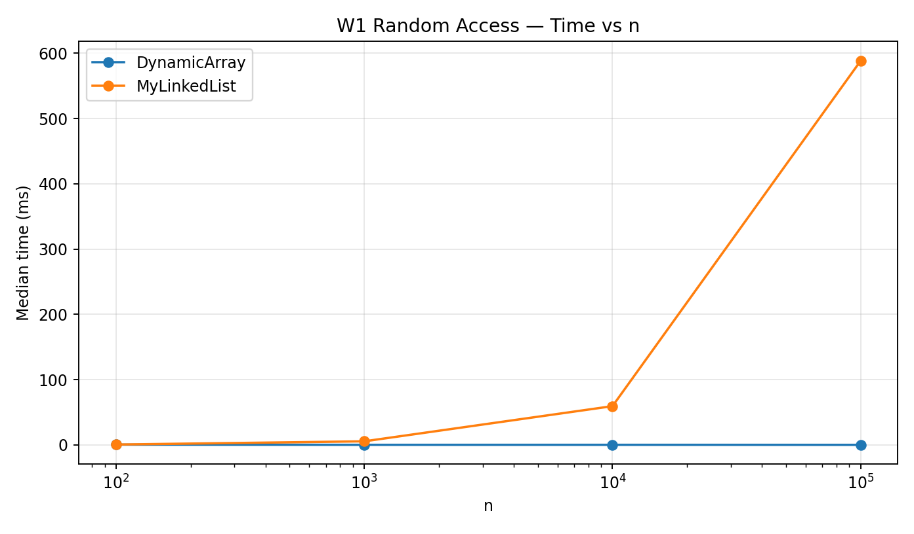
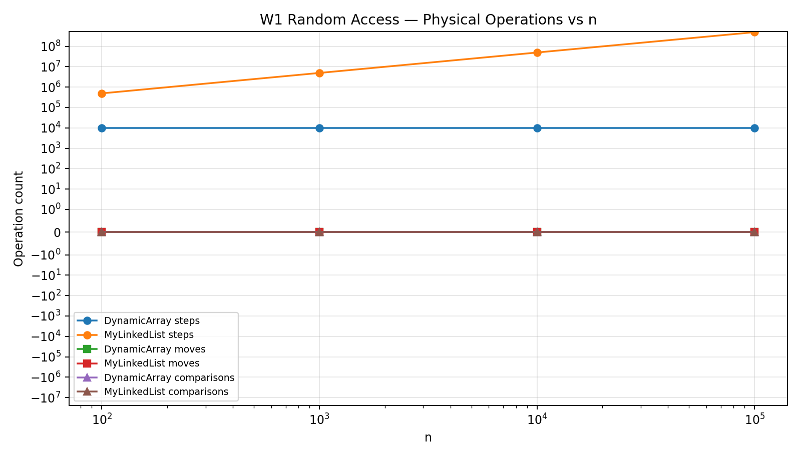
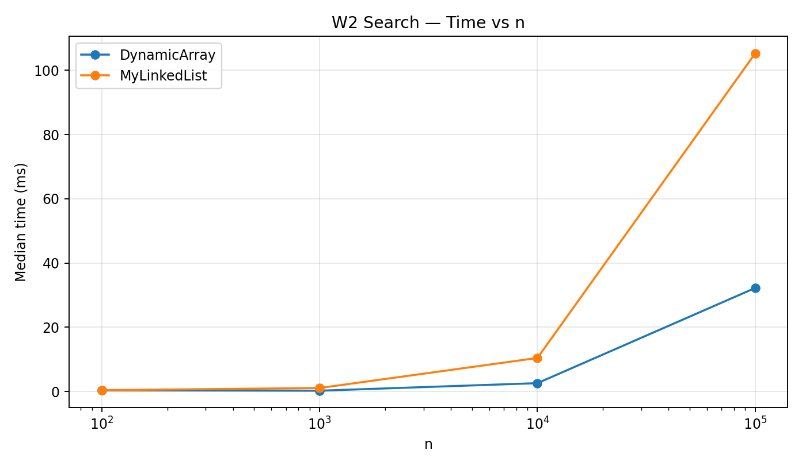
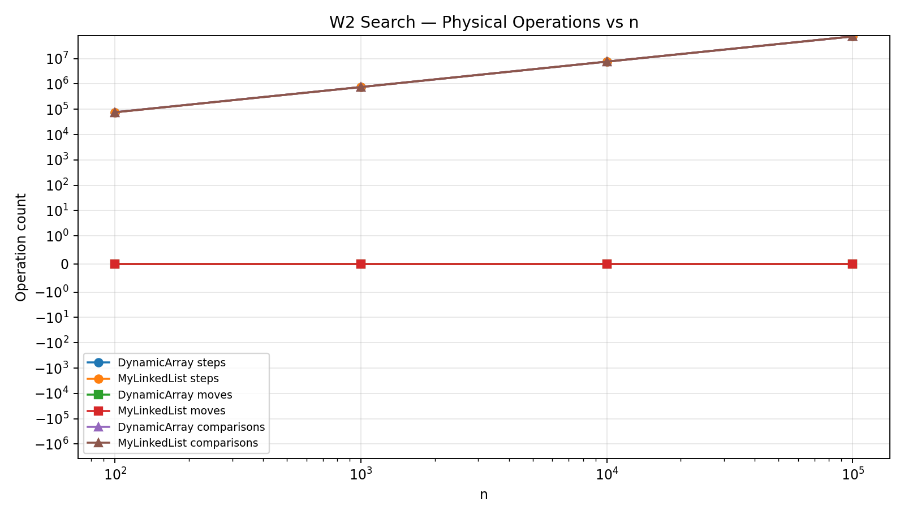
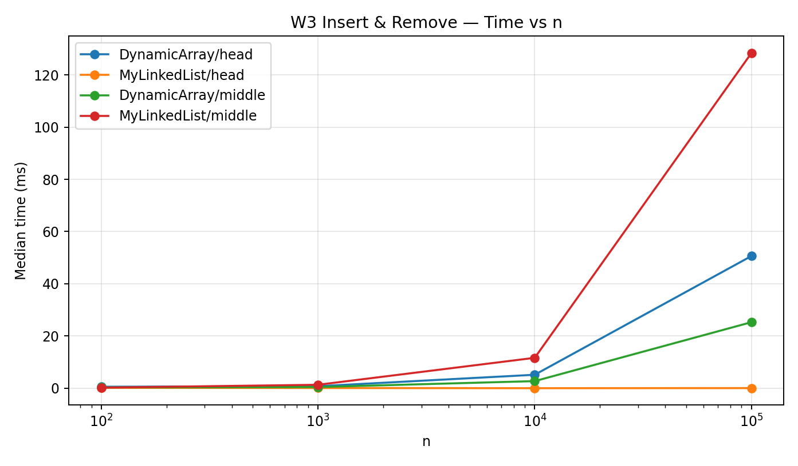
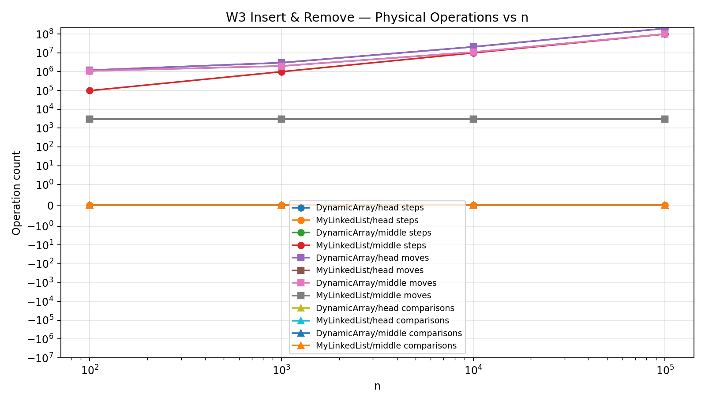
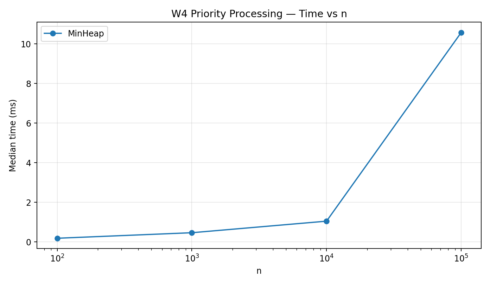
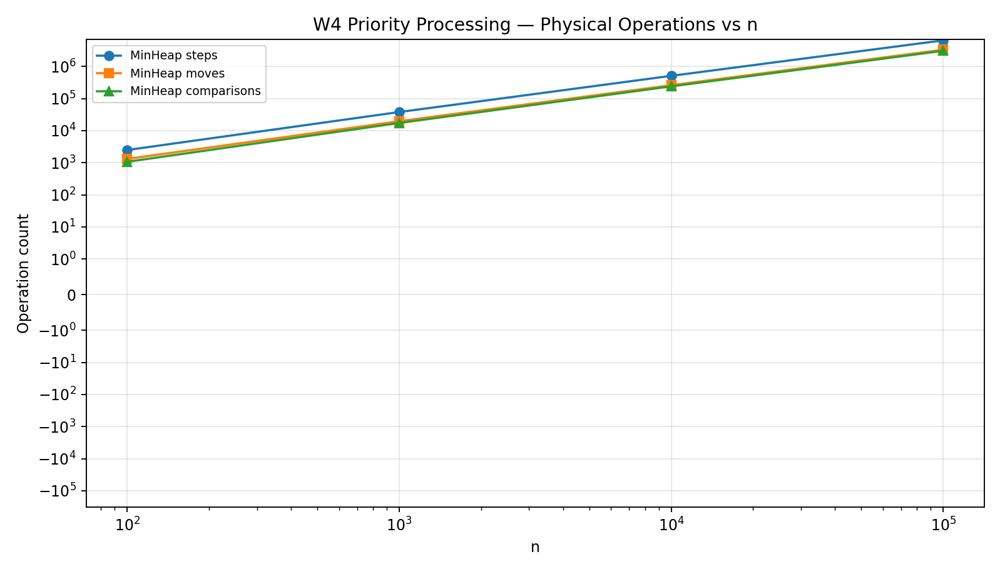

# Assignment 2 — Data Structures Report

## 1. Implementation overview

The project implements three data structures from scratch using primitive `int` values: `DynamicArray`, `MyLinkedList`, and `MinHeap`. `DynamicArray` stores values in `int[]` and doubles its capacity when full. `MyLinkedList` is a singly linked list with head and tail pointers; the tail makes append `add(x)` constant time. `MinHeap` is an array-based binary heap with bubble-up on `insert` and bubble-down on `extractMin`. The implementations do not use `ArrayList`, `LinkedList`, `PriorityQueue`, generics, or boxed `Integer` values internally.

Every data-structure operation updates an `OperationMetrics` object from inside the method. A **step** means reading an array cell or advancing to the next linked-list node, a **move** means shifting/moving an array element or updating a list pointer, and a **comparison** means comparing two stored values. The benchmark resets the counters after initial filling for W1-W3, so only the workload itself is counted. Each benchmark case has one discarded warm-up run followed by five measured runs, and the median time is written to `results/results.csv`.

## 2. Complexity analysis

| Structure | Operation | Best | Average / amortized | Worst | Auxiliary space | Justification |
|---|---|---:|---:|---:|---:|---|
| DynamicArray | `add(x)` | Θ(1) | Θ(1) amortized | Θ(n) | Θ(n) worst during resize | Usually writes at the end; a full array requires copying all `n` elements into a 2x larger array. |
| DynamicArray | `add(index,x)` | Θ(1) | Θ(n) | Θ(n) | Θ(n) worst during resize | Appending without resize is constant; insertion near the front shifts many elements. |
| DynamicArray | `remove(index)` | Θ(1) | Θ(n) | Θ(n) | Θ(1) | Removing the last element needs no shift; removing earlier positions shifts the suffix left. |
| DynamicArray | `get(index)` | Θ(1) | Θ(1) | Θ(1) | Θ(1) | Array addressing computes the cell directly. |
| DynamicArray | `contains(x)` | Θ(1) | Θ(n) | Θ(n) | Θ(1) | The first element may match, otherwise a linear scan is required. |
| MyLinkedList | `add(x)` | Θ(1) | Θ(1) | Θ(1) | Θ(1) | A maintained tail pointer allows direct append. |
| MyLinkedList | `add(index,x)` | Θ(1) | Θ(n) | Θ(n) | Θ(1) | Head/tail insertion is constant, while an internal index requires traversal. |
| MyLinkedList | `remove(index)` | Θ(1) | Θ(n) | Θ(n) | Θ(1) | Removing the head is constant; other positions require finding the previous node. |
| MyLinkedList | `get(index)` | Θ(1) | Θ(n) | Θ(n) | Θ(1) | Index 0 is the head; an arbitrary index requires following links. |
| MyLinkedList | `contains(x)` | Θ(1) | Θ(n) | Θ(n) | Θ(1) | Search stops immediately on an early match but may scan the whole list. |
| MinHeap | `insert(x)` | Θ(1) | O(log n) | Θ(log n) | Θ(n) worst during resize | The new value may already satisfy the heap property, or it may bubble to the root; array growth can temporarily require another array. |
| MinHeap | `peekMin()` | Θ(1) | Θ(1) | Θ(1) | Θ(1) | The minimum is always stored at index 0. |
| MinHeap | `extractMin()` | Θ(1) | O(log n) | Θ(log n) | Θ(1) | A one-element heap is constant; normally the last item replaces the root and may bubble down one tree height. |

## 3. Loop invariant proof 1 — `DynamicArray.contains(x)`

**Invariant.** Before each iteration with loop index `i`, none of the already processed cells `data[0..i-1]` is equal to `x`.

**Initialization.** Before the first iteration, `i = 0`. The processed prefix is empty, so it contains no value equal to `x`; therefore the invariant is true.

**Maintenance.** Assume the invariant is true before iteration `i`. The method compares `data[i]` with `x`. If they are equal, the method correctly returns `true`. If they are not equal, then `data[i]` is also known not to be `x`, so before the next iteration none of `data[0..i]` equals `x`. Thus the invariant is preserved.

**Termination.** The loop either returns `true` after finding a matching value or finishes with `i == size`. If it finishes normally, the invariant says that no element in `data[0..size-1]` equals `x`, so returning `false` is correct.

**Conclusion.** The invariant proves that `contains` never skips an unchecked element and returns `true` exactly when the array stores `x`.

## 4. Loop invariant proof 2 — shifting in `DynamicArray.remove(index)`

The shift loop is `for (int i = index; i < size - 1; i++) data[i] = data[i + 1];`.

**Invariant.** Before each iteration with index `i`, every position from the original removal index up to `i - 1` already contains the element that was originally one position to its right, while positions `i..size-1` still contain their original values.

**Initialization.** At the first iteration, `i == index`. No positions have been shifted yet, so the first part concerns an empty range and is true; all positions from `index` onward are still unchanged.

**Maintenance.** During iteration `i`, the assignment copies the original value from position `i + 1` into position `i`. Therefore positions from `index` through `i` now contain exactly the values that originally followed them by one position, and the remaining positions after `i` are unchanged. The invariant is true before the next iteration.

**Termination.** The loop stops when `i == size - 1`. At that point every position from `index` through `size - 2` has received the value that originally occupied the next cell. Decreasing `size` by one discards the duplicated final cell from the logical array.

**Conclusion.** The invariant proves that `remove(index)` preserves the order of all remaining elements and removes exactly the requested logical position.

## 5. Benchmark results

The benchmark uses `new Random(42)` for the data and sizes `100`, `1,000`, `10,000`, and `100,000`. W1 performs 10,000 random `get` calls. W2 performs 1,000 `contains` queries with exactly half present and half absent values. W3 performs 1,000 insertions and 1,000 removals at the head and at `n / 2`. W4 inserts all values into the heap, extracts all of them, and verifies non-decreasing output.

### W1 — Random Access

For `n = 100,000`, `DynamicArray` required exactly 10,000 steps for the 10,000 `get` calls, while `MyLinkedList` required 493,278,268 node-advance steps. The measured median time was approximately 0.012 ms for the array and 588.572 ms for the list on the benchmark machine. The exact array time is very small and therefore sensitive to JVM/JIT and timer noise, but the operation counts show the asymptotic difference clearly.

### W2 — Search

Both structures perform a linear number of value comparisons for `contains`, so their comparison counts are almost identical. At `n = 100,000`, both performed about 75.2 million comparisons, but the measured medians were about 32.238 ms for `DynamicArray` and 105.266 ms for `MyLinkedList`. This shows that equal Θ(n) complexity does not imply equal real running time.

### W3 — Insert & Remove

At the head, the linked list performs pointer updates without traversing nodes, while the dynamic array must shift a large suffix on every insertion and removal. For `n = 100,000`, the head variant took about 50.639 ms for `DynamicArray` versus 0.058 ms for `MyLinkedList`. In the middle variant the list must traverse roughly half the nodes for every operation; it took about 128.382 ms, while the array took about 25.294 ms because its contiguous memory shifts are cache-friendly even though both perform Θ(n)-scale work.

### W4 — Priority Processing

The min-heap maintained its heap property during tests and all `extractMin()` results were verified to be non-decreasing. At `n = 100,000`, the complete insert-and-extract workload took about 10.579 ms, with approximately 6.48 million steps, 3.32 million moves, and 3.06 million element comparisons. The observed growth is consistent with logarithmic heap adjustment per operation.

## 6. Discussion

1. `DynamicArray.get(i)` is fast because the address of the requested element is computed directly, so random access is Θ(1).
2. Array elements are stored contiguously, allowing nearby `int` values to be fetched together in CPU cache lines and giving strong spatial locality.
3. A linked list cannot calculate the address of node `i`, so it must follow `next` references one node at a time, which is pointer chasing.
4. Pointer chasing is slower because each next node can be located in a different memory region and can cause additional cache misses.
5. A linked-list node also carries object overhead in addition to its `int` value and reference, so it uses more memory than the corresponding primitive array element.
6. More node objects also create more work for the garbage collector than one primitive backing array.
7. W2 demonstrates that the same Θ(n) algorithmic bound can still produce different wall-clock times because the array has better locality than the list.
8. `DynamicArray` is a strong choice when the workload needs frequent indexed reads, iteration, and compact memory representation.
9. The cost of `DynamicArray` appears clearly in W3 head operations, where insertion and removal require shifting almost every element.
10. `MyLinkedList` is a better choice when operations are concentrated at the head or when the relevant node is already known and pointer updates can avoid shifting data.
11. The middle-index list workload remains expensive because locating the middle itself requires Θ(n) traversal before the link update.
12. `MinHeap` is the appropriate structure when the application repeatedly needs the smallest-priority job, because `peekMin` is Θ(1) and insertion/extraction require at most logarithmic tree-height adjustment.
13. Therefore the best data structure depends not only on Big-O notation but also on the exact operation pattern, memory layout, and hardware behavior.

## 7. Reproducibility

The CSV file is `results/results.csv` with columns `workload,variant,structure,n,time_ms,steps,moves,comparisons`. The Java benchmark can be rerun with `mvn -q -DskipTests compile exec:java`; this regenerates the CSV with the same fixed input data but machine-dependent times. The supplied PNG files can be regenerated from the CSV with `python tools/plot_results.py` after installing Matplotlib. Correctness tests are located under `src/test/java` and use JUnit 5; standard Java collections are used only in tests as reference implementations.
